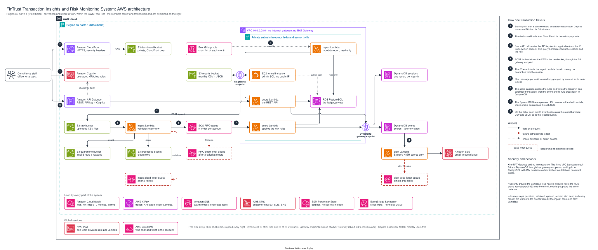

# FinTrust Transaction Insights and Risk Monitoring System

Capstone project for the Cloud to Solutions Accelerator (Praesignis), built for the fictional client **FinTrust Bank SA**.

## What this system does, in plain language

Banks must watch their customers' transactions for signs of fraud or money laundering. At FinTrust this was done by hand from exported files, which is slow and easy to get wrong.

This system does it automatically:

1. A compliance officer **uploads a file** of transactions.
2. The system **checks every line**. Lines with mistakes are set aside with the reason, so they can be corrected.
3. Each good transaction gets a **risk score** from clear rules, for example "amount above R50 000" or "sent outside South Africa". The score always shows which rules produced it.
4. Everything is **saved securely** in the bank's ledger.
5. If a transaction is high risk, the compliance team **gets an email** within seconds.
6. Staff **sign in** with their own account, a password and a code from an authenticator app, then **search, sort, filter and review** transactions, alerts and accounts on a dashboard, in light or dark mode. Only compliance officers can resolve an alert or flag an account, and every decision is recorded under their name.
7. Once a month, a **summary report** is produced for executives.

If any step fails, nothing is lost: the transaction waits in a holding area until the problem is fixed, then continues.

It runs entirely on Amazon Web Services (AWS) with no servers to manage, and is designed to cost nothing beyond the AWS Free Tier.



The same diagram as a PDF: [docs/diagrams/architecture.pdf](docs/diagrams/architecture.pdf). The numbers follow one transaction; the key is on the right of the diagram.

## Project status

| Brief slot | Phase | Status |
|---|---|---|
| Week 13 Day 1 | Design Kickoff and Infrastructure Setup | Done |
| Week 13 Day 2 | Data Layer | Done |
| Week 13 Day 3 | Security and Storage | Done |
| Week 13 Day 4 | ETL Lambda | Done |
| Week 13 Day 5 | API Backend Part 1 | Done |
| Week 14 Day 1 | Write API and Alert System | Done |
| Week 14 Day 2 | CloudWatch Monitoring and Observability | Done |
| Week 14 Day 3 | Automated Testing | Done |
| Week 14 Day 4 | SQL Analytics and Reporting Layer, and the web dashboard | Done |
| Week 14 Day 5 | End-to-End Integration and Submission | Done |
| Week 15 Day 1 | Corrections and dashboard analytics (charts) | Done |
| Week 15 Day 2 | Secure sign-in (Amazon Cognito, MFA, roles, sessions), light and dark mode, sorting and filtering, all diagrams redrawn | Done |

Progress and evidence for each phase are recorded in [docs/build-log.md](docs/build-log.md).

## Documents

| Document | What it covers |
|---|---|
| [Final audit against the brief and rubric](docs/rubric-audit.md) | Every requirement, and where the proof is. **Start here if you are assessing the project** |
| Diagrams: [AWS architecture](docs/diagrams/architecture.pdf), [ERD in UML notation](docs/diagrams/erd.pdf), [transaction pipeline sequence](docs/diagrams/pipeline-sequence.pdf), [sign-in sequence](docs/diagrams/sign-in-sequence.pdf) | The diagram deliverables as PDF, with editable draw.io sources and SVGs beside them in `docs/diagrams/` |
| [Project execution plan](docs/project-execution-plan.md) | Scope, phases, decisions |
| [Architecture](docs/architecture.md) | Diagram, data flow, why each AWS service was chosen |
| [API design](docs/api-design.md) | Every route, request, response and error |
| [Security plan and IAM role matrix](docs/security-plan.md) | Who and what can access which resource |
| [Data management design](docs/data-governance.md) | POPIA, data quality, retention, migration, risk register |
| [Data lifecycle and POPIA statement](docs/popia-lifecycle-statement.md) | The one-page summary: classification, retention tiers, access controls |
| [Well-Architected review](docs/well-architected-review.md) | An honest self-assessment against the six pillars, with gaps and next steps |
| [Demonstration runbook](docs/demo-runbook.md) | How the live demonstration is prepared and run |
| [ERD](docs/erd.md) | Database tables and relationships |
| [SQL](sql/) | `schema.sql`, `functions.sql`, `views.sql`, `db_users.sql`, `seed.sql`, `risk_report.sql`, `monthly_summary.sql` |
| [SQL analytics and the monthly report](docs/sql-analytics.md) | The window function, CTE report and views explained, with the running balance checked by hand |
| [The web dashboard](docs/dashboard.md) | What each screen does, sign-in and roles, sorting and filtering, how it is hosted and secured |
| [Testing and CI/CD](docs/testing.md) | The three test layers, fixtures, what each file covers, the CI pipeline |
| [Monitoring](docs/monitoring.md) | Metrics, alarms and what to do when one fires, dashboard, tracing |
| [Logs Insights queries](docs/logs-insights-queries.md) | Ready-made queries for the structured logs |
| [Build log](docs/build-log.md) | What was built in each phase, with test results |

## Repository layout

```
fintrust/            The Python package (one module per responsibility)
tests/unit/          Fast tests that use a fake AWS (moto); run on every push
tests/integration/   Tests that need a PostgreSQL container; run on develop only
sql/                 Database schema, seed data, reports, views, functions
infrastructure/      Scripts and policy files that create the AWS resources
scripts/             Operational scripts (end-to-end test, DLQ redrive, RDS stop/start, users, diagrams)
frontend/            The compliance dashboard (HTML, CSS, JavaScript)
data/                Sample transaction CSV files
docs/                Design documents, diagrams and evidence screenshots
.github/workflows/   Continuous integration (GitHub Actions)
```

## Run the tests on your own computer

You need Python 3.13.

```bash
python3 -m venv .venv
source .venv/bin/activate
pip install -r requirements-dev.txt
pytest
```

The tests use a simulated AWS, so they need no AWS account and cost nothing.

The integration tests also need a PostgreSQL database. With Docker running:

```bash
docker compose up -d
PGHOST=localhost PGPORT=5433 PGUSER=postgres PGPASSWORD=local-test-only pytest
docker compose down
```

Without a database those tests are skipped, not failed.

There are 1,154 tests (931 unit, 223 integration) covering 99% of the application code. GitHub Actions runs the unit tests on every push and the integration tests on the `develop` branch. See [docs/testing.md](docs/testing.md).

## Deploy to AWS

You need an AWS account, the AWS CLI configured for an **IAM user** (not the root user), and the region set to `eu-north-1`. Each step is a script that is safe to run more than once. Steps are added here as each phase is completed.

### Step 1: roles, configuration and billing alarm (Week 13 Day 1)

```bash
# Check who you are signed in as. It must NOT end in ":root".
aws sts get-caller-identity

# Create the five Lambda execution roles and their permission boundary
./infrastructure/iam/deploy_roles.sh

# Store the application settings in SSM Parameter Store
ALERT_EMAIL=you@example.com ./infrastructure/ssm/put_parameters.sh

# Create the billing alarm (email if charges pass 11 USD, about R200)
ALERT_EMAIL=you@example.com ./infrastructure/billing/create_billing_alarm.sh
```

Then open the email from AWS Notifications and choose **Confirm subscription**.

### Step 2: network, database and event store (Week 13 Day 2)

```bash
./infrastructure/network/deploy_network.sh     # private network, about 1 minute
./infrastructure/rds/deploy_rds.sh             # PostgreSQL database, about 10 minutes
./infrastructure/dynamodb/deploy_table.sh      # DynamoDB table
./infrastructure/iam/apply_data_policies.sh    # let each role reach only its own data
./infrastructure/rds/deploy_tunnel.sh          # private access for the administrator, about 5 minutes
```

The database has no public address. To load the schema, open the private tunnel in a **second** terminal window and leave it running:

```bash
./scripts/db_tunnel.sh
```

Then, back in the first window:

```bash
python scripts/run_sql.py sql/schema.sql sql/functions.sql sql/views.sql sql/db_users.sql sql/seed.sql
python scripts/run_sql.py -c "SELECT risk_level, count(*) FROM transactions GROUP BY 1 ORDER BY 1"
```

When you finish for the day, stop the database so it does not use credits:

```bash
./scripts/rds_stop.sh      # and ./scripts/rds_start.sh to resume
```

### Step 3: encryption key, buckets and queues (Week 13 Day 3)

The database does not need to be running for this step.

```bash
./infrastructure/kms/deploy_key.sh             # the project's encryption key
./infrastructure/s3/deploy_buckets.sh          # four encrypted, private buckets
./infrastructure/sqs/deploy_queues.sh          # transaction queue and dead-letter queues
./infrastructure/iam/apply_data_policies.sh    # let each role reach only its own data
python scripts/verify_storage.py               # prove every control is really in place
```

The last command checks the live account and finishes with a line such as `43 of 43 checks passed`.

### Step 4: the ingest (ETL) Lambda (Week 13 Day 4)

The database does not need to be running for this step.

```bash
./infrastructure/dynamodb/deploy_table.sh         # raise write capacity (still inside the Free Tier)
./infrastructure/lambda/deploy_function.sh ingest # package, deploy, wire the S3 trigger and dead-letter queue
python scripts/verify_ingest.py                   # upload a sample file and check what the pipeline did
```

To try it yourself, upload a file and watch the logs:

```bash
aws s3 cp data/sample_transactions_valid.csv s3://fintrust-capstone-raw-$(aws sts get-caller-identity --query Account --output text)/uploads/demo/valid.csv
aws logs tail /aws/lambda/fintrust-capstone-ingest --since 5m
```

### Step 5: scoring Lambda and the read API (Week 13 Day 5)

The database must be running for this step: `./scripts/rds_start.sh`.

Open the tunnel in a second terminal window (`./scripts/db_tunnel.sh`), then:

```bash
python scripts/run_sql.py sql/db_users.sql               # refresh database permissions
./infrastructure/lambda/deploy_function.sh score         # scoring Lambda, connected to the queue
./infrastructure/lambda/deploy_function.sh query         # API Lambda
./infrastructure/apigateway/deploy_api.sh                # REST API, usage plan and API key
python scripts/verify_scoring_api.py                     # upload a file and check everything through the API
```

To call the API yourself (since Week 15 Day 2 every route except `/health` also needs a signed-in person; `api_env.sh` signs in as the automation user and sets `$ID_TOKEN`):

```bash
source ./scripts/api_env.sh
curl -s -H "x-api-key: $API_KEY" -H "Authorization: $ID_TOKEN" "$API_URL/transactions?account_id=ACC-1007&risk_level=HIGH" | python3 -m json.tool
curl -s -H "x-api-key: $API_KEY" -H "Authorization: $ID_TOKEN" "$API_URL/insights" | python3 -m json.tool
```

### Step 6: write API and alert emails (Week 14 Day 1)

The database must be running (`./scripts/rds_start.sh`) and the tunnel open in a second terminal window (`./scripts/db_tunnel.sh`).

```bash
python scripts/run_sql.py sql/functions.sql sql/db_users.sql   # flag_account function and the right to run it
./infrastructure/iam/deploy_roles.sh                     # refresh the permission boundary
./infrastructure/sqs/deploy_queues.sh                    # adds the alert dead-letter queue
./infrastructure/ses/deploy_ses.sh                       # sends a verification email: click the link, then run again
./infrastructure/iam/apply_data_policies.sh              # alert and upload permissions
./infrastructure/lambda/deploy_function.sh query         # API Lambda with the write routes
./infrastructure/lambda/deploy_function.sh alert         # alert Lambda, connected to the DynamoDB stream
./infrastructure/apigateway/deploy_api.sh                # adds /alerts, /upload, /flag and /resolve
python scripts/verify_write_api_alerts.py                # upload through the API and check the alert email
```

To use the write routes yourself:

```bash
source ./scripts/api_env.sh
curl -s -X POST -H "x-api-key: $API_KEY" -H "Authorization: $ID_TOKEN" -H "Content-Type: text/csv" \
     --data-binary @data/sample_transactions_mixed.csv "$API_URL/upload?filename=mixed.csv" | python3 -m json.tool
curl -s -H "x-api-key: $API_KEY" -H "Authorization: $ID_TOKEN" "$API_URL/alerts?status=OPEN&sort=amount_desc" | python3 -m json.tool
curl -s -X POST -H "x-api-key: $API_KEY" -H "Authorization: $ID_TOKEN" -H "Content-Type: application/json" \
     -d '{"account_id": "ACC-1007", "reason": "Repeated high-value cross-border payments"}' "$API_URL/flag" | python3 -m json.tool
```

### Step 7: monitoring (Week 14 Day 2)

```bash
./infrastructure/kms/deploy_key.sh                       # key policy: let CloudWatch use the key
./infrastructure/lambda/deploy_function.sh ingest        # the three functions that publish metrics
./infrastructure/lambda/deploy_function.sh score
./infrastructure/lambda/deploy_function.sh alert
./infrastructure/apigateway/deploy_api.sh                # X-Ray tracing on the API stage
./infrastructure/monitoring/deploy_monitoring.sh         # alarm topic, 7 alarms, dashboard, saved queries
python scripts/verify_monitoring.py                      # real traffic, then check metrics, logs and traces
```

`deploy_monitoring.sh` sends a subscription email: click **Confirm subscription** in it before running the verifier. The database must be running for the verifier.

If the `transactions-dlq-depth` alarm fires, fix the cause and then move the waiting messages back with `./scripts/redrive_dlq.sh`.

### Step 8: SQL analytics and the monthly report (Week 14 Day 4)

The database must be running and the tunnel open in a second terminal window.

```bash
python scripts/run_sql.py sql/views.sql sql/db_users.sql   # the two views and the right to read them
python scripts/run_sql.py sql/risk_report.sql              # see the high-risk account report
./infrastructure/iam/apply_data_policies.sh                # report role: write to the reports bucket
./infrastructure/lambda/deploy_function.sh report          # the report Lambda
./infrastructure/eventbridge/deploy_schedule.sh            # run it at 06:00 on the 1st of each month
./infrastructure/monitoring/deploy_monitoring.sh           # add the report Lambda to the alarm and dashboard
python scripts/verify_report.py                            # produce real reports and check the numbers
```

To produce and read a report yourself:

```bash
aws lambda invoke --function-name fintrust-capstone-report --cli-binary-format raw-in-base64-out \
    --payload '{"month": "2026-09"}' /dev/stdout
aws s3 ls s3://fintrust-capstone-reports-$(aws sts get-caller-identity --query Account --output text)/monthly/ --recursive
```

### Step 9: the web dashboard (Week 14 Day 4)

The database must be running. The first run takes 5 to 15 minutes while CloudFront rolls out.

```bash
./infrastructure/frontend/deploy_frontend.sh             # private bucket, CloudFront, files, CORS, API redeploy
python scripts/verify_dashboard.py                       # hosting, security headers, CORS and chart data checks
```

The script prints the dashboard's address. Sign-in is added in Step 11.

After changing a file in `frontend/`, run `deploy_frontend.sh` again.

### Step 10: end-to-end test and nightly stop (Week 14 Day 5)

The database must be running and the tunnel open in a second terminal window.

```bash
python scripts/e2e_test.py                               # the whole system, including fail-and-recover (about 9 minutes)
./infrastructure/scheduler/deploy_nightly_stop.sh        # stop the database automatically at 20:00 every day
```

`python scripts/e2e_test.py --skip-dlq` is a 2-minute version that needs no tunnel.

### Step 11: secure sign-in, roles and sessions (Week 15 Day 2)

The database must be running and the tunnel open in a second terminal window. `ALERT_EMAIL` is the same address as in Step 1.

```bash
python scripts/run_sql.py sql/migrations/w15d2_flagged_by.sql sql/functions.sql sql/db_users.sql   # who flagged an account
./infrastructure/dynamodb/deploy_table.sh                # adds the sign-in session table
./infrastructure/iam/apply_data_policies.sh              # query role: the session table only
for f in ingest score alert report query; do ./infrastructure/lambda/deploy_function.sh $f; done
./infrastructure/cognito/deploy_auth.sh                  # user pool, MFA, two roles, sign-in pages, automation user
./infrastructure/apigateway/deploy_api.sh                # Cognito sign-in on every route except /health
python scripts/manage_users.py create --username n.hlongwane --name "Nolwazi Hlongwane" \
    --email "$ALERT_EMAIL" --role compliance-officer     # your own account: the invitation is emailed
./infrastructure/frontend/deploy_frontend.sh             # the dashboard with sign-in, themes, sorting and filtering
./infrastructure/monitoring/deploy_monitoring.sh         # two new saved queries: who did what, refused requests
python scripts/verify_auth.py                            # sign-in settings, then sign in, use, sign out, token refused
python scripts/verify_dashboard.py
```

Open the dashboard, sign in with the username and the temporary password from the invitation email, choose your own password, and scan the QR code with an authenticator app (Microsoft Authenticator or Google Authenticator). After that, every sign-in asks for the 6-digit code.

To give a colleague access, or take it away (the example is an analyst, Thabo Nkosi):

```bash
python scripts/manage_users.py create --username t.nkosi --name "Thabo Nkosi" \
    --email thabo.nkosi@fintrust.example --role compliance-analyst
python scripts/manage_users.py list
python scripts/manage_users.py set-role --username t.nkosi --role compliance-officer
python scripts/manage_users.py end-sessions --username t.nkosi    # signed out everywhere, at once
python scripts/manage_users.py disable --username t.nkosi         # cannot sign in again; history kept
```

## Diagrams

Every diagram is generated from `scripts/build_diagrams.py` (the ERD from the UML class diagram in `docs/erd.md`) and drawn by draw.io with the official AWS icons. To change one, change the generator, not the picture, then:

```bash
python scripts/build_diagrams.py                         # writes the four .drawio files
git clone --depth 1 https://github.com/jgraph/drawio.git ../drawio
python scripts/export_diagrams.py --webapp ../drawio/src/main/webapp   # writes the .svg and .pdf
pytest tests/unit/test_demo_tools.py                     # checks every picture matches its source
```

## Keeping the cost at zero

The database is the only part that uses credits while idle. Stop it when you finish, and start it before you work or demonstrate:

```bash
./scripts/rds_stop.sh
./scripts/rds_start.sh       # takes about 5 minutes
```

It is also stopped automatically at 20:00 South African time every day. Everything else (Lambda, API Gateway, queues, DynamoDB, S3, CloudFront) costs nothing when not in use.

## Demonstrating the system

```bash
python scripts/ready_check.py         # is everything the demonstration needs ready? changes nothing
python scripts/make_demo_file.py      # writes a fresh 12-row file and prints what to expect
```

Upload the file on the dashboard and follow [docs/demo-runbook.md](docs/demo-runbook.md). One row is for an account that does not exist yet: it fails three times, waits in the dead-letter queue, and is recovered with:

```bash
python scripts/onboard_account.py ACC-9...     # the account id printed by make_demo_file.py
./scripts/redrive_dlq.sh
```

## Sample data

| File | Contents |
|---|---|
| `data/sample_transactions_valid.csv` | 15 valid transactions across 9 accounts |
| `data/sample_transactions_mixed.csv` | 11 rows: 4 valid and 7 with deliberate errors, one per validation rule |

CSV columns: `transaction_id, account_id, tx_date, amount, currency, tx_type, channel, merchant_name, country_code, description`. `currency`, `merchant_name` and `description` are optional.

## Branching and commits

- `main`: reviewed, working releases. `develop`: integration branch. `feature/<name>`: one piece of work, merged into `develop` by pull request.
- Commit messages follow [Conventional Commits](https://www.conventionalcommits.org/): `feat(config): load settings from SSM Parameter Store`.

## Author

Nolwazi Hlongwane, Cloud to Solutions Accelerator, 2026.
