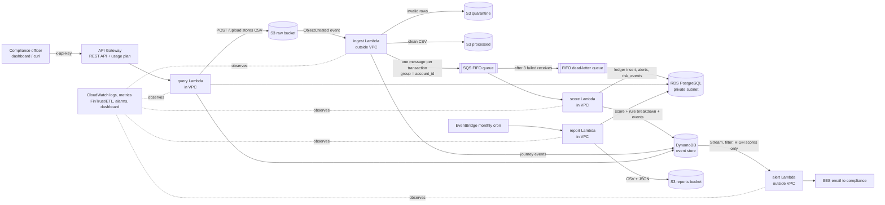

# Architecture

**Brief slot:** Week 13 Day 1: Design Kickoff and Infrastructure Setup · **Status:** draft, updated as each phase is deployed.
The final draw.io diagram and its PDF export are kept in `docs/diagrams/`.

## Diagram

Security boundaries: everything sits in one AWS account in **eu-north-1 (Stockholm)**. RDS and the three Lambdas that use it (score, query, report) are inside the VPC's private subnets. There is no internet gateway route from those subnets and no NAT Gateway. The only public entry point is API Gateway, which requires an API key.

## How the pieces connect (plain language)

| Step | What happens | Why it is built this way |
|---|---|---|
| 1. Upload | CSV lands in the **raw** S3 bucket (through `POST /upload` or a direct upload). | S3 is cheap, durable storage, and it can start a Lambda by itself when a file arrives. |
| 2. Ingest | S3 starts the **ingest** Lambda. It validates each row. Bad rows go to the **quarantine** bucket with the reason. Good rows are written to the **processed** bucket and sent to the queue, one message per transaction. | Validation at the door stops bad data reaching the ledger (data quality, POPIA accuracy). |
| 3. Queue | The **SQS FIFO** queue holds messages in order per account. | The queue *decouples* ingest from scoring: if scoring is slow or broken, nothing is lost. FIFO keeps one account's transactions in order, which the velocity rule needs. |
| 4. Score | The **score** Lambda reads from the queue, applies the risk rules, writes the transaction to **RDS** and the score with its rule breakdown to **DynamoDB**. | One place owns scoring and both writes, so the ledger and the event store cannot drift apart. |
| 5. Failure | If a message fails three times it moves to the **dead-letter queue (DLQ)** and an alarm fires. | Nothing is silently dropped. The message waits until a human fixes the cause and redrives it. |
| 6. Alert | DynamoDB Streams passes HIGH scores to the **alert** Lambda, which emails compliance through **SES**. | Alerting is separate from scoring, so an email failure can never block or roll back a ledger write. |
| 7. Read | **API Gateway** checks the API key and calls the **query** Lambda, which reads RDS and DynamoDB. | Managed entry point with authentication and throttling, no servers. |
| 8. Report | **EventBridge** runs the **report** Lambda monthly; it runs the CTE report on RDS and writes CSV and JSON to the **reports** bucket. | Scheduled, automatic executive reporting. |

## The network design (the no-NAT constraint)

The brief forbids a NAT Gateway. A Lambda inside a private subnet therefore has **no route to the internet**, so it can only reach AWS services that have a free *gateway endpoint* (S3 and DynamoDB). That single fact decides where each Lambda lives:

| Lambda | In VPC? | Talks to | Why |
|---|---|---|---|
| ingest | No | S3, SQS, DynamoDB | Never touches RDS, and needs SQS (no free endpoint). |
| score | **Yes** | RDS, DynamoDB | Needs RDS. Reaches DynamoDB through the free gateway endpoint. SQS *delivers* to it, so it needs no route to SQS. |
| alert | No | SES, DynamoDB | SES has no free endpoint. Never touches RDS. |
| query | **Yes** | RDS, DynamoDB, S3 | Needs RDS. S3 and DynamoDB through free gateway endpoints. |
| report | **Yes** | RDS, S3 | Needs RDS. S3 through the free gateway endpoint. |

Three consequences, each a deliberate decision:

1. **Alert is triggered by a DynamoDB Stream**, not a direct Lambda-to-Lambda call, because the score Lambda cannot reach the Lambda service from inside the VPC.
2. **Database login uses IAM database authentication**, not a stored password. The Lambda signs a 15-minute login token with its own IAM role, which needs no network call. This removes the need to reach Secrets Manager or SSM from inside the VPC, and means no database password exists in any Lambda. (Changed from the earlier default of an SSM SecureString, which the VPC Lambdas could not have reached.)
3. **Configuration:** SSM Parameter Store is the single source of truth. The two non-VPC Lambdas read it at cold start. For the three VPC Lambdas the deploy script copies the same values from SSM into environment variables. `config.py` handles both the same way: environment variable first, then SSM.

## Why each service was chosen (SAA-C03 decision framework)

| Service | Resilience | Security | Performance | Cost |
|---|---|---|---|---|
| **S3** | 11 nines durability; versioning protects against overwrite | KMS encryption, Block Public Access, bucket policy requires TLS | Scales without limits for file drops | 5 GB free; lifecycle rules move old data to cheaper storage |
| **Lambda** | Runs across multiple AZs automatically; retries on failure | One least-privilege role per function | Scales per event, warm containers reuse connections | Pay per request, nothing when idle |
| **SQS FIFO + DLQ** | Messages survive a scoring outage; DLQ keeps failed messages for 14 days | Encrypted with KMS; only ingest may send, only score may receive | Buffers bursts so RDS is not overwhelmed | 1M requests free |
| **RDS PostgreSQL** | Automated backups; Multi-AZ is the documented production upgrade | Private subnets, no public endpoint, security group allows port 5432 from the Lambda security group only, IAM database authentication, encrypted at rest | Indexed relational queries, joins, window functions | db.t3.micro, stopped outside working hours |
| **DynamoDB** | Multi-AZ by default, no maintenance | Encrypted at rest by default, access by IAM, holds no customer details | Single-digit millisecond lookups by account | 25 GB and 25 capacity units free |
| **API Gateway** | Managed, multi-AZ | API key, usage plan throttling, TLS only | Handles bursts without servers | 1M calls free |
| **SES** | Managed delivery with retries | Verified identities only; role limited to one sender | Asynchronous from scoring | 3,000 messages free |
| **EventBridge** | Managed scheduler with retries | Can invoke only the report Lambda | Not applicable | Free |
| **CloudWatch** | Alarms detect failure early | Logs carry identifiers, never personal details | Logs Insights queries on JSON fields | Within 10 metrics and 10 alarms |
| **KMS** | Key managed and backed up by AWS | Customer-managed key, key policy, rotation enabled | Transparent | About $1 per month |
| **VPC endpoints (gateway)** | Not a single point of failure | Traffic to S3 and DynamoDB stays on the AWS network | No NAT hop | Free, replaces a $32 per month NAT Gateway |

**Why two databases?** The ledger needs relationships, constraints and transactions that either fully happen or fully roll back, so it is relational (RDS). Scores and journey events are written once and read by a known key (account, then time), so they suit a key-value store (DynamoDB). This is the "purpose-built database" principle.

## The network design (no NAT Gateway)

A Lambda inside a private subnet has no route to the internet, so it can only reach AWS services that have a free gateway endpoint: S3 and DynamoDB.

| Lambda | In VPC? | Talks to | Why |
|---|---|---|---|
| ingest | No | S3, SQS, DynamoDB | Never touches RDS, and needs SQS, which has no free endpoint. |
| score | Yes | RDS, DynamoDB | Needs RDS. SQS delivers messages to it, so it needs no route to SQS. |
| alert | No | SES, DynamoDB | SES has no free endpoint. Never touches RDS. |
| query | Yes | RDS, DynamoDB, S3 | Needs RDS. |
| report | Yes | RDS, S3 | Needs RDS. |

Consequences: the alert Lambda is triggered by a DynamoDB Stream instead of a direct call; the database uses IAM authentication instead of a stored password; and the VPC Lambdas receive their configuration as environment variables copied from SSM at deploy time.

## Failure handling

| Failure | What happens | How it is recovered |
|---|---|---|
| A CSV row is invalid | Row is written to the quarantine bucket with the reason; valid rows continue | Data steward corrects and re-uploads |
| The ingest Lambda crashes | Lambda retries twice, then sends the event to the ingest DLQ | Re-upload the file or replay the event |
| The score Lambda fails on a message | The database transaction is rolled back; SQS redelivers; after 3 failed receives the message moves to the FIFO DLQ and an alarm fires | Fix the cause, then redrive the DLQ |
| One account's message is stuck | Only that account's message group waits; other accounts keep flowing | Automatic once the message reaches the DLQ |
| SES rejects an email | The ledger and score are already saved; the stream retries the alert | Automatic retry, then on-failure destination |
| An Availability Zone fails | Lambda, SQS, DynamoDB, S3 and API Gateway continue in other AZs. RDS single-AZ is the one exposed component | Production design: RDS Multi-AZ with automatic failover (not deployed: outside Free Tier) |
