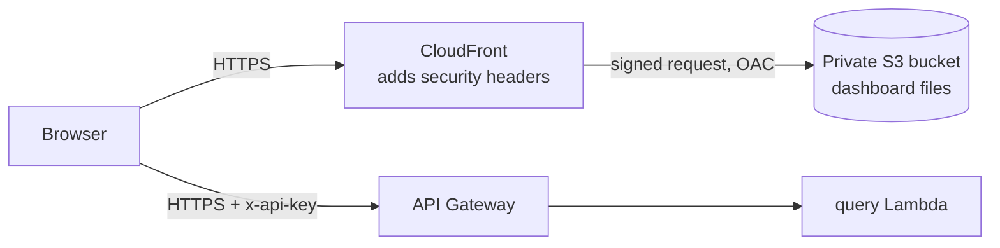

# The Web Dashboard

**Brief slot:** Week 14 Day 4 (part 2), confirmed with the facilitator as an addition to the backend brief
**Files:** `frontend/` (the pages), `infrastructure/frontend/` (hosting)

The dashboard is the compliance officer's view of the system. It is four small files of plain HTML, CSS and JavaScript with no framework, no build step and no third-party code. Every number on screen comes from the real API; nothing is mocked.

## What it does

| Section | What you can do | API routes used |
|---|---|---|
| **Overview** | See totals, the split of Low, Medium and High, which rules fired, and the accounts with the most high-risk transactions, for any date range | `GET /insights` |
| **Transactions** | Search by account, risk level and date; page through results; select a row to open its journey | `GET /transactions`, `GET /transactions/{id}/journey` |
| **Alerts** | See open or resolved alerts; resolve one with your username and a note | `GET /alerts`, `POST /resolve` |
| **Accounts** | See every account ranked by risk points; flag an account with a reason | `GET /accounts`, `POST /flag` |
| **Upload a file** | Send a CSV, then watch each transaction move through the pipeline live | `POST /upload`, `GET /transactions/{id}/journey` |

### The journey panel

Selecting any transaction opens a panel that answers two questions:

- **Why this score?** The score out of 100 and each rule that fired with its points, for example "+50 High amount: Amount 88750.00 is above 50000".
- **What happened to it?** Each step with its time: received, passed validation, queued, scored, alert emailed. Failed scoring attempts appear in red with the reason, ending in "Moved to the dead-letter queue; nothing is lost."

This is the explainability part of the project: no score is a black box, and a failed transaction is visible, not silently missing.

Transactions loaded as opening data (the three months of seed history) did not pass through the pipeline, so they have no steps. Their score and rules are read from the ledger instead.

### Live progress after an upload

After a file is accepted, the page reads the transaction ids from the file and asks the API where each one is every four seconds, for up to four minutes. It follows the first 12, to stay well inside the API's limit of 10 requests a second. A row that fails validation never gets a record, and the page says so.

## How it is hosted



| Part | Setting | Why |
|---|---|---|
| S3 bucket `fintrust-capstone-dashboard-<account>` | All public access blocked; not an S3 website | The files can only be reached through CloudFront |
| Origin Access Control (OAC) | CloudFront signs every request to S3 | S3 can tell the request really came from CloudFront |
| Bucket policy | Allows `s3:GetObject` to the CloudFront service, only when the request comes from this one distribution; denies anything not over TLS | Another CloudFront distribution, even in another account, cannot read the bucket |
| CloudFront | Redirects http to https; read-only methods (GET, HEAD) | Nothing is ever sent unencrypted |
| Response headers policy | Content-Security-Policy, HSTS, `X-Frame-Options: DENY`, `nosniff`, no referrer | See below |
| Encryption at rest | SSE-S3 | The files are public web pages with no data in them, and using the project KMS key would mean giving CloudFront rights on it |

Deploy or update it with `./infrastructure/frontend/deploy_frontend.sh`. The script also writes `config.js` with the API address, tells the API to accept browser calls from the dashboard's address only, and redeploys the API Lambda and the API.

## Security

| Risk | Control |
|---|---|
| The API key leaks | It is typed in by the user and kept in `sessionStorage`: this tab only, gone when the tab closes. It is never in a file, a URL or the page's HTML. A test fails the build if a key-shaped string appears in `frontend/` |
| A value from the API runs as script (cross-site scripting) | The script puts text on the page with `textContent` only; it never builds HTML from data. A test fails the build if `innerHTML` or similar appears |
| Injected script anyway | The Content-Security-Policy allows only the page's own script file, no inline script or style, and connections only to this project's API address |
| Another website calls the API using a logged-in user's browser | CORS: the API returns the dashboard's address as the only allowed origin, so a browser will not let any other site read a response. API Gateway's own error responses carry the same address |
| The page is shown inside another site's frame to trick clicks | `frame-ancestors 'none'` and `X-Frame-Options: DENY` |
| Someone reads the files straight from S3 | Refused (403). Only the distribution can read the bucket |

What CORS does and does not do: it stops **other websites** from reading the API through a visitor's browser. It is not authentication. A script or `curl` ignores CORS, which is why every route still needs the API key and the usage plan still applies.

A note on the API key in a browser: an API key identifies an application, not a person. For a production bank system the dashboard would sign users in with Amazon Cognito (or the bank's identity provider) and the API would check a token per user. The brief specifies API key authentication, so that is what is built, with the key never stored.

## Running it on your own computer

```bash
cd frontend && python3 -m http.server 8080
```

Open `http://localhost:8080`, enter the API address and key. The deployed API only accepts browser calls from the CloudFront address, so for local development add your local address to the allowed list, redeploy, and remove it afterwards:

```bash
aws ssm put-parameter --name /fintrust/dev/cors_allowed_origin --type String --overwrite \
    --value "$(aws ssm get-parameter --name /fintrust/dev/dashboard_url --query Parameter.Value --output text),http://localhost:8080"
./infrastructure/lambda/deploy_function.sh query
```

## Design

A quiet page for people who read tables all day: bottle-green ink on cool paper, one brass accent for "where you are", and three colours (green, amber, red) used only for risk and never for decoration. The one distinctive element is the journey, drawn as a route with a station for each step. It works on a phone, shows keyboard focus, and respects the reduced-motion setting.
