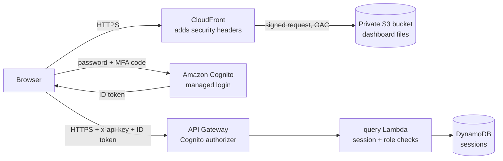

# The Web Dashboard

**Brief slot:** Week 14 Day 4 (part 2), confirmed with the facilitator as an addition to the backend brief
**Charts added:** Week 15 Day 1 (corrections and dashboard analytics), see [Charts](#charts-week-15-day-1)
**Sign-in, roles, appearance, sorting and filtering:** Week 15 Day 2, see [Sign-in and roles](#sign-in-and-roles-week-15-day-2) and [Finding things](#finding-things-sorting-and-filtering-week-15-day-2)
**Files:** `frontend/` (the pages), `infrastructure/frontend/` (hosting), `infrastructure/cognito/` (sign-in)

The dashboard is the compliance team's view of the system. It is a handful of small files of plain HTML, CSS and JavaScript with no framework, no build step and no third-party code. Every number on screen comes from the real API; nothing is mocked. Nobody can see anything until they have signed in with their own account and an authenticator code.

## What it does

| Section | What you can do | API routes used |
|---|---|---|
| **Sign in** | Sign in with your own FinTrust account: password, then a 6-digit code from your authenticator app | Amazon Cognito, then `POST /session` |
| **Overview** | See totals, the split of Low, Medium and High and which rules fired; six charts (activity over time, score spread, alerts raised and resolved, fraud ranking, running balance); for any date range, with quick periods and zoom by selecting a bar | `GET /insights`, `GET /insights/trends`, `GET /accounts/{id}/balance` |
| **Transactions** | Filter by account, risk level, dates, type, channel, country, amount range and merchant; sort by date, amount, account, merchant (A to Z) or score; page through results; select a row to open its journey | `GET /transactions`, `GET /transactions/{id}/journey` |
| **Alerts** | See open, resolved or all alerts; filter by account and dates; sort by date, amount, score or account; resolve one (officers), recorded under your username with an optional note | `GET /alerts`, `POST /resolve` |
| **Accounts** | Every account with its risk picture; search, filter by status and type; sort by risk points, account (A to Z), most recent activity, transactions, high-risk count or open alerts; flag an account with a reason (officers) | `GET /accounts`, `POST /flag` |
| **Upload a file** | Send a CSV, then watch each transaction move through the pipeline live | `POST /upload`, `GET /transactions/{id}/journey` |
| **Your menu** (top right) | See who you are and your role; choose System, Light or Dark appearance; see when your session ends; sign out | `GET /session`, `DELETE /session` |

### The journey panel

Selecting any transaction opens a panel that answers two questions:

- **Why this score?** The score out of 100 and each rule that fired with its points, for example "+50 High amount: Amount 88750.00 is above 50000".
- **What happened to it?** Each step with its time: received, passed validation, queued, scored, alert emailed. Failed scoring attempts appear in red with the reason, ending in "Moved to the dead-letter queue; nothing is lost."

This is the explainability part of the project: no score is a black box, and a failed transaction is visible, not silently missing.

Transactions loaded as opening data (the three months of seed history) did not pass through the pipeline, so they have no steps. Their score and rules are read from the ledger instead.

### Live progress after an upload

After a file is accepted, the page reads the transaction ids from the file and asks the API where each one is every four seconds, for up to four minutes. It follows the first 12, to stay well inside the API's limit of 10 requests a second. A row that fails validation never gets a record, and the page says so.

## Sign-in and roles (Week 15 Day 2)

The data is confidential: customer transactions, risk scores and fraud alerts. So the dashboard asks **who** is using it, not only which application. Sign-in uses **Amazon Cognito**, the AWS service for user sign-in.

| What the person sees | What happens underneath |
|---|---|
| "Sign in to the risk desk" | The dashboard sends the browser to Cognito's sign-in page (managed login, hosted by AWS). The dashboard's own code never sees a password |
| Username and password, then a 6-digit code | MFA is required for everyone. The first sign-in asks the person to choose a new password and link an authenticator app |
| Back on the dashboard, their name and role top right | The authorization code flow with PKCE returns an ID token (30 minutes) and a refresh token (8 hours). The dashboard records the sign-in with `POST /session` |
| After 14 minutes without activity: "Are you still there?" with a countdown | After 15 minutes the session ends on the server. The same token is refused from then on |
| "Sign out" | The session ends on the server (`DELETE /session`), the refresh token is revoked at Cognito, and Cognito's own sign-in cookie is cleared |

The full sequence is drawn in [diagrams/sign-in-sequence.pdf](diagrams/sign-in-sequence.pdf).

**Two roles**, as Cognito groups:

| Role | May |
|---|---|
| `compliance-analyst` | Read everything and upload files |
| `compliance-officer` | Everything an analyst may, plus resolve alerts and flag accounts |

The dashboard hides the Resolve and Flag buttons from analysts, but that is only courtesy: the API refuses the request with 403 whatever the page does. A signed-in person who is in neither group can see nothing and is told to ask an administrator. Accounts are created by an administrator only (`scripts/manage_users.py`); there is no self sign-up.

**Why a session record as well as a token?** A token cannot be cancelled once issued. The session record in DynamoDB can, so signing out, the idle time-out and an administrator ending a session all take effect at once, not when the token expires.

## Light and dark appearance (Week 15 Day 2)

The menu offers **System** (follow the device, the default), **Light** and **Dark**; the moon or sun button next to it switches straight between the two. The choice is remembered in this browser only. `theme.js` runs before the page is drawn, so it never flashes the wrong colours. Every colour is a named token with a light and a dark value, and the risk colours keep their contrast in both. Charts redraw with the theme.

## Finding things: sorting and filtering (Week 15 Day 2)

- **Sort two ways.** Use the "Sort by" list, or select a column heading: once for one direction, again for the other. The heading shows the direction, and a screen reader is told.
- **Sorting is done by the database, not the page.** The page shows 25 rows at a time, so sorting only those 25 would be wrong. The API sorts the whole result in PostgreSQL, from a fixed list of allowed orders, and every order ends with a tie-breaker (newest first, then the id) so paging never repeats or skips a row.
- **Alphabetical sorting ignores case**: "acme" and "Acme" sort together, and rows with no merchant go last.
- **Filters show as chips** above the results ("Money out ×", "R 50 000 or more ×"). Select a chip to remove that filter, or "Clear all filters".
- **The address keeps the view.** Filters and sort are in the page address, so the browser's Back button works and a view can be bookmarked or shared with a colleague (who still has to sign in).
- **Rules are checked twice.** The page catches a From date after a To date, or a smallest amount above the largest, before asking; the API checks every value again and answers 400 with a clear message.

## On a phone

Below 640 pixels wide each results row becomes a card, with every value labelled by its column, so nothing is hidden off the side of the screen. The filters stack two to a row, and sorting is done with the "Sort by" list.

## Charts (Week 15 Day 1)

The Overview shows six pictures. Each one is a view of something the backend already works out; the browser only draws it. That keeps the project backend-heavy, as the brief intends, and means every chart can be checked against SQL.

| Chart | The question it answers | Where the numbers come from |
|---|---|---|
| Risk levels (share bar) | What share of transactions is Low, Medium, High? | `GET /insights` |
| Rules that fired | Which risk rule is doing the work? | `GET /insights` |
| Activity over time | How much was processed per day, week or month, and when did risk rise? | `GET /insights/trends` → `activity` (`date_trunc` on South African days) |
| How scores are spread | Where do the thresholds cut the scores? | `GET /insights/trends` → `score_distribution`, with the Medium (40) and High (70) thresholds marked |
| Alerts raised and resolved | Is compliance keeping up? Median time to resolve | `GET /insights/trends` → `alert_flow` (`percentile_cont`) |
| Fraud ranking | Which accounts stand out, and did any break the 30-day burst rule? | `GET /insights/trends` → `account_ranking`: the `PERCENT_RANK` and rolling 30-day window of `sql/risk_report.sql`, tested to agree with it |
| Running balance | What did this account's money do, and where were its high-risk transactions? | `GET /accounts/{id}/balance`: `sql/monthly_summary.sql`, the hand-verified window function, run as it is |

What makes them useful rather than decoration:

- **They are linked.** Selecting an account in the ranking draws its running balance. Selecting a point on the balance opens that transaction's journey: why it got its score and every step it took. Selecting a week in Activity or Alerts zooms the whole page into that week (bars become days).
- **The numbers reconcile.** Activity adds up exactly to the figures at the top; the ranking agrees with `risk_report.sql`; the balance agrees with `monthly_summary.sql` and the eight rows worked by hand in `docs/sql-analytics.md`. Integration tests check all three, and `scripts/verify_dashboard.py` checks the first on the real account.
- **A chosen period keeps the true balance.** The balance is worked out over the account's whole history first, then rows outside the period are dropped. Filtering first would restart it at zero.
- **Every chart has its numbers.** "Show the numbers" opens a table of exactly what is drawn: the accessible version for screen readers, and the auditable version for anyone who wants to check.
- **Keyboard and screen reader.** Each chart can be focused; the arrow keys move from bar to bar (or point to point), Enter selects, and the tooltip is read out.
- **Colour is never the only signal.** The Low, Medium and High fill colours were checked with a colour-vision simulation (OKLab ΔE, deuteranopia and protanopia): the old Medium and High were 3.3 apart for a deuteranope, nearly the same colour; the new ones are at least 8.0 apart. Every chart also has a legend, a tooltip naming the level, and its table.
- **No chart library.** The charts are SVG built by `frontend/charts.js` (under 400 lines). A library would mean loading third-party code, which the Content-Security-Policy (`script-src 'self'`) forbids, or relaxing that policy. It would also be code I could not explain line by line.
- **Failure is contained.** The figures (`/insights`) and the charts (`/insights/trends`) are asked for together but separately. If one fails, the other still shows, with the request id of the failure.

### The Total value figure

The five figures at the top used to share the row equally, so a rand amount such as R 6 038 764,84 (about twice as long as a count) ran into the Active accounts figure. The row is now six equal columns and the money figure takes two; on smaller screens the money figure takes a row of its own and the others go two to a row. The value never wraps and its size scales with the screen (`clamp()`). A test guards the layout. "Active accounts" is now **"Accounts with transactions"**: it counts accounts with activity in the period, which includes flagged accounts, so "active" was misleading next to an account whose status is Flagged.

## How it is hosted

| Part | Setting | Why |
|---|---|---|
| S3 bucket `fintrust-capstone-dashboard-<account>` | All public access blocked; not an S3 website | The files can only be reached through CloudFront |
| Origin Access Control (OAC) | CloudFront signs every request to S3 | S3 can tell the request really came from CloudFront |
| Bucket policy | Allows `s3:GetObject` to the CloudFront service, only when the request comes from this one distribution; denies anything not over TLS | Another CloudFront distribution, even in another account, cannot read the bucket |
| CloudFront | Redirects http to https; read-only methods (GET, HEAD) | Nothing is ever sent unencrypted |
| Response headers policy | Content-Security-Policy, HSTS, `X-Frame-Options: DENY`, `nosniff`, no referrer | See below |
| Encryption at rest | SSE-S3 | The files are public web pages with no data in them, and using the project KMS key would mean giving CloudFront rights on it |

Deploy or update it with `./infrastructure/frontend/deploy_frontend.sh`. The script also writes `config.js` with the API address, the dashboard's API key and the Cognito sign-in address, tells the API to accept browser calls from the dashboard's address only, and redeploys the API Lambda (with `monthly_summary.sql` and `risk_report.sql` packaged inside it) and the API (with any new routes in `openapi.json`).

## Security

| Risk | Control |
|---|---|
| Someone without an account opens the page | They see only the sign-in screen. Every API route except `GET /health` needs a valid Cognito ID token, checked by API Gateway, and an open session, checked by the query Lambda |
| A password is guessed or phished | MFA is required: a stolen password alone does not sign anyone in. Cognito answers the same way whether or not a username exists |
| A laptop is left open | The session ends after 15 minutes without activity, on the server as well as on the page |
| Tokens are stolen from the page | They are kept in `sessionStorage` (this tab only, gone when it closes), never in a cookie, a URL or a file. The ID token lasts 30 minutes. Signing out revokes the refresh token and ends the session, so a copied token stops working at once |
| A sign-in response is forged | PKCE and a random `state`: the code is useless without the verifier that never leaves the tab, and a response this tab did not ask for is refused |
| The dashboard's API key is seen | It is in `config.js`, which anyone who can load the page can read, and that is expected: an API key identifies the **application** for the usage plan's limits; it is not a password. On its own it opens nothing except `GET /health`. A test fails the build if a key-shaped string is committed to `frontend/` |
| A value from the API runs as script (cross-site scripting) | The script puts text on the page with `textContent` only; it never builds HTML from data. A test fails the build if `innerHTML` or similar appears |
| Injected script anyway | The Content-Security-Policy allows only the page's own script file, no inline script or style, and connections only to this project's API address |
| Another website calls the API using a logged-in user's browser | CORS: the API returns the dashboard's address as the only allowed origin, so a browser will not let any other site read a response. API Gateway's own error responses carry the same address |
| The page is shown inside another site's frame to trick clicks | `frame-ancestors 'none'` and `X-Frame-Options: DENY` |
| Someone reads the files straight from S3 | Refused (403). Only the distribution can read the bucket |

What CORS does and does not do: it stops **other websites** from reading the API through a visitor's browser. It is not authentication. A script or `curl` ignores CORS, which is why every route still needs the API key and the usage plan still applies.

**API key and sign-in together.** The brief asks for API key authentication, and that is kept on every route: it names the application and enforces the usage plan's limits. Week 15 Day 2 adds what an API key cannot do: name the **person**. API Gateway checks both, and the query Lambda checks the session and the role.

## Trying a change

Sign-in only returns people to the dashboard's own CloudFront address, and the API only accepts browser calls from it, so the page is not run against the real API from a laptop. A change is checked by the tests (`pytest tests/unit/test_frontend.py` checks the layout rules, the Content-Security-Policy, the absence of `innerHTML`, and the sort orders against the API), then published with `./infrastructure/frontend/deploy_frontend.sh`, which takes about a minute and invalidates CloudFront's copy.

## Design

A quiet page for people who read tables all day: bottle-green ink on cool paper, one brass accent for "where you are", and three colours (green, amber, red) used only for risk and never for decoration. The one distinctive element is the journey, drawn as a route with a station for each step. It works on a phone, in light and dark, shows keyboard focus, and respects the reduced-motion setting.
