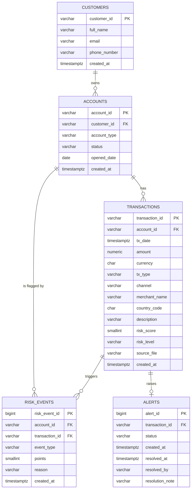

# Entity Relationship Diagram

**Brief slot:** Week 13 Day 1: Design Kickoff (draft). Confirmed against the deployed schema in Week 13 Day 2, when the draw.io version and PDF are added to `docs/diagrams/`.
**Status:** draft.

## Normalisation notes (3NF)

- **1NF:** every column holds one value. The rules that fired for a transaction are separate rows in `risk_events`, not a list in one column.
- **2NF:** every table has a single-column primary key, so no column can depend on part of a key.
- **3NF:** non-key columns depend only on the key. Customer details live only in `customers`, not repeated on accounts or transactions. `alerts` does not repeat the account or the score, because both are reachable through `transaction_id`.
- **`risk_level` beside `risk_score`:** the level is the classification in force when the transaction was scored. The thresholds are configurable, so the level cannot be derived from the score alone later. It is a recorded fact of the scoring decision, not a derived column.

## Relationship to DynamoDB

RDS is the system of record. The DynamoDB table `fintrust-capstone-events` (partition key `account_id`, sort key beginning with `tx_timestamp`) holds a fast-lookup copy of each score with its rule breakdown, plus the processing journey of each transaction. It holds no customer details.
