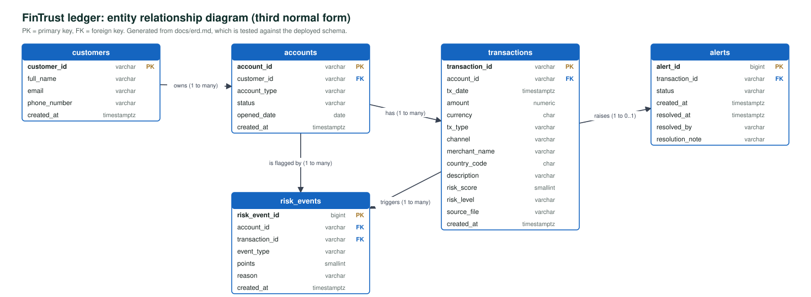
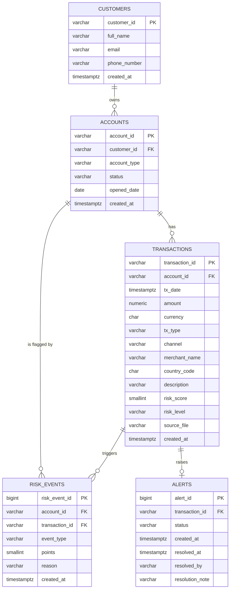

# Entity Relationship Diagram

**Brief slot:** Week 13 Day 1: Design Kickoff (draft); confirmed in Week 13 Day 2: Data Layer.
**Status:** matches `sql/schema.sql` exactly. This is checked automatically: `tests/integration/test_erd_matches_schema.py` reads the tables, columns, types and keys from a real PostgreSQL database and fails the build if this diagram differs. The diagram deliverable is [diagrams/erd.pdf](diagrams/erd.pdf), with an editable draw.io source in [diagrams/erd.drawio](diagrams/erd.drawio); both are generated from the diagram source below, so they match it.

## Normalisation notes (3NF)

- **1NF:** every column holds one value. The rules that fired for a transaction are separate rows in `risk_events`, not a list in one column.
- **2NF:** every table has a single-column primary key, so no column can depend on part of a key.
- **3NF:** non-key columns depend only on the key. Customer details live only in `customers`, not repeated on accounts or transactions. `alerts` does not repeat the account or the score, because both are reachable through `transaction_id`.
- **`risk_level` beside `risk_score`:** the level is the classification in force when the transaction was scored. The thresholds are configurable, so the level cannot be derived from the score alone later. It is a recorded fact of the scoring decision, not a derived column.

## Constraints that are not visible in the diagram

| Rule | How the database enforces it |
|---|---|
| Amounts are positive and exact | `NUMERIC(14,2)` with `CHECK (amount > 0)` |
| Only known types, channels, levels and statuses | `CHECK` constraints on each column |
| A transaction must belong to an existing account | Foreign key `fk_transactions_account` |
| A rule fires at most once per transaction | Unique index on (`transaction_id`, `event_type`) |
| One alert per transaction | `UNIQUE (transaction_id)` on `alerts` |
| A resolved alert records who and when | `CHECK` across `status`, `resolved_at`, `resolved_by` |
| Ledger rows cannot be orphaned | `ON DELETE RESTRICT` on every foreign key |

Indexes: `transactions(account_id)`, `transactions(tx_date)`, `transactions(account_id, tx_date)`, `transactions(risk_level)`, `accounts(customer_id)`, `risk_events(account_id)`, `risk_events(transaction_id)`, `alerts(status)`.

## Views and the stored function

These are not entities, so they are not in the diagram. They are built on the five tables above.

| Object | Kind | Built on | Purpose |
|---|---|---|---|
| `v_risk_dashboard` | View | `accounts`, `transactions`, `alerts`, `risk_events` | One row per account with its risk picture |
| `v_open_alerts` | View | `alerts`, `transactions`, `accounts`, `risk_events` | The open alert work queue |
| `flag_account(account_id, reason)` | Function | `accounts`, `risk_events` | Flags an account and records why, atomically |

See [sql-analytics.md](sql-analytics.md).

## Relationship to DynamoDB

RDS is the system of record. The DynamoDB table `fintrust-capstone-events` (partition key `account_id`, sort key `tx_timestamp`, whose value begins with the transaction time followed by the transaction id) holds a fast-lookup copy of each score with its rule breakdown, plus the processing journey of each transaction. It holds no customer details.
