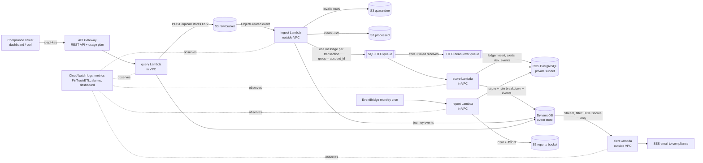

# FinTrust Project Execution Plan

**Project:** Cloud-Based Transaction Insights and Risk Monitoring System, FinTrust Bank SA
**Owner:** Nolwazi Hlongwane
**Written:** 6 October 2026 · **Build deadline:** 9 October 2026 (end of Week 14)
**Sources:** Praesignis Capstone Brief (authoritative), Assessment Rubric, FinTrust Project Plan. Where they disagree, the brief wins.

---

## 1. What we are building, in one paragraph

A compliance officer uploads a CSV of bank transactions. The system checks every row, sets bad rows aside, scores each good transaction for risk using clear rules, stores it in a relational ledger and a fast-lookup event store, emails compliance when a transaction is high risk, exposes everything through a secure REST API and a small web dashboard, and writes a monthly report. Everything is serverless and sized to stay inside the AWS Free Tier.

## 2. Architecture

This is the flow rubric C1 names for full marks: **S3 → ingest Lambda → SQS FIFO → scoring Lambda → RDS + DynamoDB → API Gateway → SES**.

### How the pieces connect (plain language)

| Step | What happens | Why it is built this way |
|---|---|---|
| 1. Upload | CSV lands in the **raw** S3 bucket (through `POST /upload` or a direct upload). | S3 is cheap, durable storage, and it can start a Lambda by itself when a file arrives. |
| 2. Ingest | S3 starts the **ingest** Lambda. It validates each row. Bad rows go to the **quarantine** bucket with the reason. Good rows are written to the **processed** bucket and sent to the queue, one message per transaction. | Validation at the door stops bad data reaching the ledger (data quality, POPIA accuracy). |
| 3. Queue | The **SQS FIFO** queue holds messages in order per account. | The queue *decouples* ingest from scoring: if scoring is slow or broken, nothing is lost. FIFO keeps one account's transactions in order, which the velocity rule needs. |
| 4. Score | The **score** Lambda reads from the queue, applies the risk rules, writes the transaction to **RDS** and the score with its rule breakdown to **DynamoDB**. | One place owns scoring and both writes, so the ledger and the event store cannot drift apart. |
| 5. Failure | If a message fails three times it moves to the **dead-letter queue (DLQ)** and an alarm fires. | Nothing is silently dropped. The message waits until a human fixes the cause and redrives it. |
| 6. Alert | DynamoDB Streams passes HIGH scores to the **alert** Lambda, which emails compliance through **SES**. | Alerting is separate from scoring, so an email failure can never block or roll back a ledger write. |
| 7. Read | **API Gateway** checks the API key and calls the **query** Lambda, which reads RDS and DynamoDB. | Managed entry point with authentication and throttling, no servers. |
| 8. Report | **EventBridge** runs the **report** Lambda monthly; it runs the CTE report on RDS and writes CSV and JSON to the **reports** bucket. | Scheduled, automatic executive reporting. |

### The network design (the no-NAT constraint)

The brief forbids a NAT Gateway. A Lambda inside a private subnet therefore has **no route to the internet**, so it can only reach AWS services that have a free *gateway endpoint* (S3 and DynamoDB). That single fact decides where each Lambda lives:

| Lambda | In VPC? | Talks to | Why |
|---|---|---|---|
| ingest | No | S3, SQS, DynamoDB | Never touches RDS, and needs SQS (no free endpoint). |
| score | **Yes** | RDS, DynamoDB | Needs RDS. Reaches DynamoDB through the free gateway endpoint. SQS *delivers* to it, so it needs no route to SQS. |
| alert | No | SES, DynamoDB | SES has no free endpoint. Never touches RDS. |
| query | **Yes** | RDS, DynamoDB, S3 | Needs RDS. S3 and DynamoDB through free gateway endpoints. |
| report | **Yes** | RDS, S3 | Needs RDS. S3 through the free gateway endpoint. |

Three consequences, each a deliberate decision:

1. **Alert is triggered by a DynamoDB Stream**, not a direct Lambda-to-Lambda call, because the score Lambda cannot reach the Lambda service from inside the VPC.
2. **Database login uses IAM database authentication**, not a stored password. The Lambda signs a 15-minute login token with its own IAM role, which needs no network call. This removes the need to reach Secrets Manager or SSM from inside the VPC, and means no database password exists in any Lambda. (Changed from the earlier default of an SSM SecureString, which the VPC Lambdas could not have reached.)
3. **Configuration:** SSM Parameter Store is the single source of truth. The two non-VPC Lambdas read it at cold start. For the three VPC Lambdas the deploy script copies the same values from SSM into environment variables. `config.py` handles both the same way: environment variable first, then SSM.

## 3. AWS services and the purpose of each

| Service | Purpose here | Free Tier note |
|---|---|---|
| **S3** | Four data buckets: raw, processed, quarantine, reports. One more for the dashboard files. | 5 GB |
| **Lambda** | Exactly five functions: ingest, score, alert, query, report. Python 3.13. | 1M requests |
| **SQS FIFO + DLQ** | Ordered per-account queue between ingest and score; FIFO DLQ after 3 failures. A second, standard DLQ catches failed ingest invocations. | 1M requests |
| **RDS PostgreSQL** | Transaction ledger, system of record. db.t3.micro, single-AZ, private subnets, no public endpoint, stopped outside working hours. | Uses credits on your plan |
| **DynamoDB** | Event store: risk scores, rule breakdown, and the per-transaction journey. Partition key `account_id`, sort key starts with `tx_timestamp`. | 25 GB |
| **API Gateway (REST)** | Entry point with API key and usage plan. REST type is required because HTTP APIs do not support API keys. | 1M calls |
| **SES** | High-risk alert emails. Sandbox, verified address. | 3,000 messages |
| **EventBridge** | Monthly cron for the report Lambda. | Free |
| **CloudWatch** | Structured JSON logs, custom metrics in `FinTrust/ETL`, alarms (error rate, high-risk count, DLQ depth), dashboard, Logs Insights queries. | 10 metrics, 10 alarms |
| **X-Ray** | Tracing enabled on the Lambdas and API stage. | 100k traces |
| **IAM** | One least-privilege role per Lambda, no wildcard actions, one permission boundary on all five. | Free |
| **VPC** | Two private subnets in two AZs, security groups (Lambda → RDS on 5432 only), S3 and DynamoDB gateway endpoints. No NAT. | Free |
| **KMS** | One customer-managed key encrypting the four buckets and the queues. | About $1/month from credits |
| **SSM Parameter Store** | Application configuration under `/fintrust/dev/`. | Free (standard tier) |
| **CloudFront** | Serves the dashboard over HTTPS from a private bucket. | Free tier |

**Not used, by decision:** NAT Gateway (brief), Step Functions, FastAPI and SQLAlchemy (in the Project Plan but not the brief), Secrets Manager (cost; IAM database auth instead), Multi-AZ RDS (cost; documented as the production design).

## 4. The "wow factor": resilience and explainability

Agreed on 6 October. No AI component.

1. **Break it and recover, live.** The demo CSV contains one transaction for an account that has not been onboarded yet. The ledger's foreign key rejects it, scoring fails three times, the message moves to the DLQ, the alarm fires. Then the account is onboarded, the DLQ is redriven with one command, and the transaction is processed. Nothing lost. Meanwhile every other account kept flowing, because FIFO only blocks the affected account's message group.
2. **Transaction journey.** Click a transaction on the dashboard to see its real timeline (received → validated → queued → scored → alerted, or the failed attempts), read from the DynamoDB event log.
3. **Explainable scores.** Every score stores which rules fired and the points each added. The dashboard and the alert email both show the breakdown.

Redrive is a one-line script by default. A dashboard "Redrive" button is a stretch goal only if time allows, because the query Lambda cannot reach SQS from inside the VPC.

## 5. Risk scoring model (default, agreed)

| Rule | Condition | Points |
|---|---|---|
| HIGH_AMOUNT | amount > R50 000 | 50 |
| HIGH_VELOCITY | more than 10 transactions on the account in 60 minutes | 30 |
| CROSS_BORDER | country code is not ZA | 20 |

Score 0 to 100. **LOW** below 40, **MEDIUM** 40 to 69, **HIGH** 70 and above. HIGH sends an email. All numbers live in configuration, not in code.

## 6. Requirements by pillar

### SQL and data model (rubric C2, 15 points)

- Tables: `customers`, `accounts`, `transactions`, `risk_events`, `alerts`. 3NF, primary and foreign keys, NOT NULL, CHECK constraints, indexes on `account_id` and `tx_date`.
- Six artefacts: `schema.sql`, `seed.sql` (200+ transactions, 3 months), `risk_report.sql` (CTE, more than 3 high-risk transactions in a rolling 30 days, plus PERCENT_RANK ranking), `monthly_summary.sql` (running balance window function, hand-verified with the working shown), `views.sql`, `functions.sql` (`flag_account`).
- ERD as a diagram that matches the deployed schema exactly.
- Three database users, one per VPC Lambda, each with only the rights it needs.

### Python (rubric C3, 15 points)

- Package `fintrust/` with all ten modules: `config`, `db`, `dynamo`, `models`, `validators`, `ingest`, `score`, `alert`, `query`, `report`. Plus a small `log` helper.
- Boto3 clients at module level. One reused database connection per Lambda container. Every `psycopg2` except block calls `conn.rollback()`. `json.dumps(default=str)` on all responses. Structured JSON logs through `print()`. Pinned `requirements.txt`.

### API (brief Week 13 Day 5 and Week 14 Day 1)

| Method | Route | Purpose |
|---|---|---|
| GET | /health | Liveness check |
| GET | /transactions | Paginated, filtered by account |
| GET | /transactions/{id}/journey | Journey and score breakdown |
| GET | /insights | Risk summary |
| GET | /alerts | Open and resolved alerts |
| POST | /upload | Accept CSV, return 202, processing continues asynchronously |
| POST | /flag | Flag an account (calls `flag_account`) |
| POST | /resolve | Resolve an alert |

All routes need an `x-api-key` header. Consistent JSON error shape with correct status codes (400, 403, 404, 413, 500).

### Frontend

Plain HTML, CSS and JavaScript calling the real API: transaction search, risk insights, alerts with resolve, CSV upload, journey view. The API key is typed in by the user and kept in the browser session only. Hosted on S3 behind CloudFront.

### Testing and CI/CD (rubric C4, 10 points)

- `pytest` with `moto` `@mock_aws` fixtures in `conftest.py`. Unit tests for every module, integration tests against moto plus a real PostgreSQL container.
- GitHub Actions: unit tests on every push, integration tests on `develop` only.
- `scripts/e2e_test.py` run against the real deployed system, output saved as evidence.
- DLQ behaviour tested and evidenced.

### Data governance (rubric C5, 10 points)

One design document with all five elements: POPIA field classification, data quality framework, lifecycle policy (RDS 12 months, S3 3 years, Glacier 7 years), migration strategy (AWS Application Migration Service, Replatform, justified), risk register (three risks with probability, impact and a named AWS control).

### Documentation (rubric C6, 10 points)

Architecture diagram (draw.io, PDF), ERD, API design document, security plan and IAM role matrix, POPIA and lifecycle statement, risk register, Well-Architected self-assessment, evidence screenshots, a README a non-technical reader can follow, Conventional Commits history.

## 7. Phases and order

Each phase is labelled with its brief slot. Real dates are compressed into four days.

| Brief slot | Phase | What gets built | Real date |
|---|---|---|---|
| Week 13 Day 1 | Design Kickoff and Infrastructure Setup | Repo and structure, `config.py`, IAM roles, design drafts (architecture, API, IAM matrix, governance, ERD) | Tue 6 Oct |
| Week 13 Day 2 | Data Layer | VPC, RDS, `schema.sql` and all SQL artefacts, DynamoDB table, `db.py`, `dynamo.py`, `models.py` | Tue 6 Oct |
| Week 13 Day 3 | Security and Storage | KMS key, four buckets, queues and DLQs, least-privilege policies completed, S3 trigger | Wed 7 Oct |
| Week 13 Day 4 | ETL Lambda | `validators.py`, `ingest.py`, deployed and tested | Wed 7 Oct |
| Week 13 Day 5 | API Backend Part 1 | `score.py`, `query.py` GET routes, API Gateway with API key | Wed 7 Oct |
| Week 14 Day 1 | Write API and Alert System | POST routes, `alert.py`, SES | Thu 8 Oct |
| Week 14 Day 2 | Monitoring and Observability | Metrics, alarms, dashboard, Logs Insights queries, X-Ray | Thu 8 Oct |
| Week 14 Day 3 | Automated Testing | Full suite, integration job in CI | Thu 8 Oct |
| Week 14 Day 4 | SQL Analytics and Reporting | `report.py`, EventBridge cron, frontend dashboard | Fri 9 Oct |
| Week 14 Day 5 | End-to-End and Submission | E2E script, DLQ recovery evidence, Well-Architected review, final rubric audit, screenshots | Fri 9 Oct |

`score.py` is built on Day 5 with the read API because nothing reaches RDS until it exists. Tests are written with each module, not left to Week 14 Day 3; that day completes coverage and the integration job.

After every phase: run the tests, check against the brief and rubric, record the result in `docs/build-log.md`, and stop for review.

## 8. What Nolwazi must do by hand

| When | Task |
|---|---|
| Now | As root: Account page → activate "IAM user and role access to Billing information". Billing preferences → Alert preferences → Edit → tick "CloudWatch billing alerts". |
| Now | Sign out of root. Do all building as your IAM user. Root is for billing settings only. |
| Now | `aws configure` for your IAM user with region `eu-north-1`; confirm with `aws sts get-caller-identity`. |
| Now | Create an empty GitHub repository `fintrust-risk-system`. |
| Day 1 | Run the IAM, SSM and billing alarm scripts; confirm the SNS email. |
| Week 14 Day 1 | Click the SES verification link emailed to your Gmail. |
| Each phase | Run the deploy script provided, take the evidence screenshots listed, commit with the messages provided. |
| Daily | Stop RDS when you finish (`scripts/rds_stop.sh`). AWS restarts a stopped instance after 7 days. |
| Final | Export the draw.io diagrams to PDF. |

The billing console shows "Global" because billing is not tied to a region. All project resources are created in **Europe (Stockholm), eu-north-1**. The billing alarm alone lives in us-east-1, because that is the only region where AWS publishes billing metrics.

## 9. What a distinction needs

Distinction is 85 or more, which means the Exceeds level on most criteria. The gap between Meets and Exceeds on each one:

| Criterion | The detail that earns full marks |
|---|---|
| C1 (20) | Every role least-privilege, RDS with no public endpoint, **DLQ behaviour tested**, **billing evidence** |
| C2 (15) | All six artefacts, running balance **hand-verified**, ERD matches the deployed schema **exactly** |
| C3 (15) | All ten modules, module-level clients, rollback on **every** exception path, JSON logging throughout, pinned requirements |
| C4 (10) | moto fixtures in `conftest.py`, CI green on **every** push, integration scoped to `develop`, E2E run against the real system |
| C5 (10) | All five governance elements, each specific to this system |
| C6 (10) | Every checklist artefact, non-technical README, **Conventional Commits** with incremental history |
| C7 (10) | Demo end to end without failure; every answer names parts of your own architecture |
| C8 (10) | Technical choices tied to risk reduction, cost containment and compliance posture |

## 10. Risks and open decisions

| # | Risk or decision | Handling |
|---|---|---|
| 1 | Four real days for ten brief days | Tests written with each module; nothing optional is started until the checklist is complete. |
| 2 | A service may be restricted on the credits-only Free plan | We find out on the day each service is first created; if blocked we stop and decide together. |
| 3 | Git history will show four days, not two weeks | Accepted. Commit dates stay real; commits are small and meaningful. |
| 4 | RDS is private, so SQL cannot be run from your Mac directly | **Decision for Day 2:** a small private EC2 instance reached through EC2 Instance Connect Endpoint, with no public IP and no open inbound port, used as an SSH tunnel for `psql`. Stopped when not in use. |
| 5 | "Survive a simulated AZ failure" on single-AZ RDS | Subnets span two AZs; the single-AZ limit and the Multi-AZ production design are documented. |
| 6 | Credit use (RDS, KMS key, EC2 tunnel instance) | Billing alarm at $11; RDS and EC2 stopped outside working hours. |
| 7 | Live demo depends on RDS being started | Demo runbook with a start-up checklist 30 minutes before. |
| 8 | Facilitator answers to the clarification questions may differ from the defaults | Each default is isolated in configuration or one module where possible, so a late correction is a small change. |
